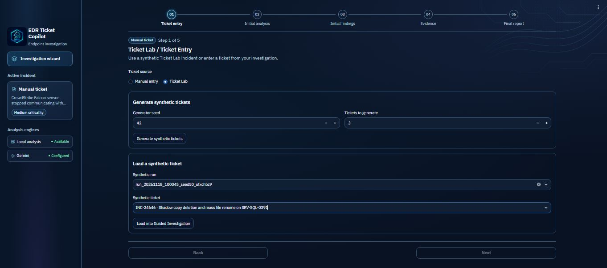
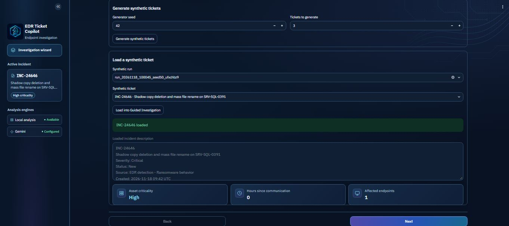

# EDR Ticket Copilot

**v0.5.0-rc1 · AI-assisted endpoint security investigation and triage**

EDR Ticket Copilot is a Python-based investigation prototype designed to help endpoint security analysts triage incidents, interpret security alerts, assess supporting evidence, and generate structured investigation reports.

The project combines deterministic security rules with Google Gemini-assisted analysis through a guided five-step Streamlit workflow.

**Supported RC scope:** Single-user evaluation on a trusted workstation using synthetic or redacted data. Run the app on loopback. Public hosting, shared access, and production investigations are outside the supported scope.

## Key Features

- **Guided investigation wizard:** Ticket Entry → Initial Analysis → Initial Findings → Evidence Investigation → Final Report.
- **Rule-based triage:** Local incident classification, heuristic severity scoring, and investigation priority recommendations.
- **IOC extraction:** Identification of candidate IPv4 addresses, domains, URLs, and cryptographic hashes, including partial-hash handling.
- **AI-assisted analysis:** Google Gemini integration for preliminary incident assessment, investigation recommendations, and evidence reassessment.
- **Screenshot evidence review:** Manual uploads stage a validated file list for explicit confirmation. Accepted screenshots carry source identifiers and SHA-256 hashes.
- **Structured reporting:** Exportable Markdown and JSON investigation outputs.
- **Local case management:** SQLite-backed investigations with saved wizard progress, lifecycle actions, and protection against stale writes and accidental loss of unsaved edits.
- **Investigation history:** Read-only snapshots, historical screenshot provenance, analyst notes, and byte-exact downloads of issued reports.
- **Analyst feedback:** Optional case verdicts and separate quality ratings for specific saved AI responses.
- **Synthetic incident testing:** Ticket Lab scenarios for investigating suspicious endpoint activity without requiring a production EDR environment.


## Historical screenshots

These screenshots show an earlier build using synthetic Ticket Lab data. They predate the RC case workspace, current AI trust labels, and manual screenshot confirmation flow. Use the workflow instructions below for the RC.

### 1. Investigation Wizard

Five-step guided workflow for endpoint security investigations.



### 2. Synthetic Ticket Lab

Generate, select, and load synthetic EDR incidents for testing.



### 3. Initial Findings

Rule-based severity assessment, IOC extraction, ticket
validation, and AI-assisted incident analysis.


### 4. Evidence Submission

Review and submit endpoint screenshots for evidence reassessment.


### 5. Evidence Reassessment

Detection of conflicting endpoint information across evidence
sources, with recommendations for further investigation.


## Technology Stack

- Python 3.11
- Streamlit 1.67.0 or later in the 1.x series
- Google Gemini API (`google-genai`)
- Pillow
- python-dotenv
- tldextract
- Python `unittest`
- SQLite via Python's standard library. Dependency ranges are in `requirements.txt`. Release verification uses Streamlit 1.67.0.

## Getting Started

### Prerequisites

- Python 3.11 or compatible version
- Git
- Optional: Google Gemini API key for AI-assisted features

### Select the RC source

To try the RC branch after it is available on GitHub, clone it explicitly.

```bash
git clone --branch feature/case-management https://github.com/prosteanvlad24-hub/edr-ticket-copilot.git
cd edr-ticket-copilot
```

Once the `v0.5.0-rc1` tag is published, use the following commands from an existing clone to check out that exact release.

```bash
git fetch origin tag v0.5.0-rc1
git switch --detach v0.5.0-rc1
```

### Installation

From the repository root, use Python 3.11 to create a virtual environment.

```bash
python -m venv .venv
```

On Windows PowerShell, activate the environment with the following command.

```powershell
.\.venv\Scripts\Activate.ps1
```

On macOS or Linux, activate it with the following command.

```bash
source .venv/bin/activate
```

Install the declared dependencies in the active environment.

```bash
python -m pip install -r requirements.txt
```

### Optional Gemini configuration

Local analysis, cases, and reports work without a Gemini key. To enable the optional Gemini actions, set `GEMINI_API_KEY` in the environment or in a local `.env` file in the project directory.

```env
GEMINI_API_KEY=your_api_key_here
```

Never commit API keys or credentials to version control.

### Run the Application

```bash
python -m streamlit run dashboard_v1_2.py --server.address=127.0.0.1
```

Open `http://127.0.0.1:8501` on the machine running the app. Launch from the repository root so Streamlit loads the bundled configuration. EDR Ticket Copilot is intended for local, single-analyst use.

## Cases and analyst decisions

Use **Case Management** to create, open, archive, or restore a case. The canonical initial status is `DRAFT`. Submitting the ticket advances it to `IN_PROGRESS`. From there, the analyst can put the case `ON_HOLD` or close it as `CLOSED_RESOLVED` or `CLOSED_INCONCLUSIVE`. Resume a held case and reopen a closed case to continue work. Archive keeps the case data and restore returns it to its previous status. `OPEN` is not a stored lifecycle value.

For a dirty investigation, Save, Discard, or Cancel resolves a case switch. A failed or stale save keeps the draft in the current session. **Analyst decisions** in Case Management lets you record an optional incident verdict separately from an optional rating of a specific saved AI output. The lifecycle, verdict, and rating are independent. Archived cases retain their decisions and can be restored before adding new ones.

**Case History** shows read-only saved versions, screenshot provenance, and analyst notes without replacing the active draft. **Issue report for saved version** stores Markdown and JSON together and links displayed AI outputs to their recorded ratings. Later downloads return the issued bytes. The wizard's ordinary export does not issue a case-history record.

### Local storage

Set `EDR_CASE_DB_PATH` to an absolute path outside the checkout to override the default. The default is `%LOCALAPPDATA%\edr-ticket-copilot\cases.sqlite3` on Windows when that variable is set, or `$XDG_DATA_HOME/edr-ticket-copilot/cases.sqlite3` on other systems when set. The fallback is `~/.local/share/edr-ticket-copilot/cases.sqlite3`. The database contains ticket text, prepared screenshot bytes, model output, and analyst records. Restrict access to the database, SQLite sidecars, and backups using OS permissions and host encryption where appropriate.

## Investigation Workflow

1. **Ticket Entry:** Enter incident details manually or select a synthetic Ticket Lab scenario.
2. **Initial Analysis:** Run local classification, severity assessment, IOC extraction, and optional AI analysis.
3. **Initial Findings:** Review preliminary results and investigation recommendations.
4. **Evidence Investigation:** Inspect Ticket Lab evidence or stage manual uploads. Confirm the displayed manual replacement list before applying it. Gemini reassessment requires a separate, fresh authorization.
5. **Final Report:** Review and export the investigation findings.

### Confirm manual screenshot replacements

Uploading files stages a candidate without changing accepted evidence or its reassessment. A batch containing an invalid file that reaches Python is rejected as a whole. Streamlit can reject files in the browser before Python receives them. The app cannot tell whether a missing file was rejected or never selected, and an entirely rejected selection may leave an earlier candidate visible if Streamlit sends no change event.

Review the exact filenames beside **Apply screenshot replacement**. Apply only when the displayed list matches the intended replacement. For a saved case, a successful replacement creates one new version and invalidates the previous reassessment. Failed or stale saves preserve the accepted evidence. **Clear uploaded screenshots** is a separate, explicit action.

## Automated Testing

Run the suite with the project's interpreter on Streamlit 1.67.0. For isolated verification, use a scratch working directory and a disposable database. Discovery includes a script that writes `EDR_Incident_Report_Test.md` to the working directory. The suite mocks Gemini submissions.

```powershell
$project = (Get-Location).Path
$python = Join-Path $project '.venv\Scripts\python.exe'
$scratch = New-Item -ItemType Directory -Path (Join-Path ([IO.Path]::GetTempPath()) ([guid]::NewGuid().ToString()))
$env:EDR_CASE_DB_PATH = Join-Path $scratch.FullName 'cases.sqlite3'
Push-Location $scratch.FullName
try { & $python -B -m unittest discover -v -s $project -t $project }
finally { Pop-Location; Remove-Item Env:EDR_CASE_DB_PATH }
```

On other platforms, use `.venv/bin/python` and the same discovery arguments with the repository's absolute path, a temporary working directory, and a disposable `EDR_CASE_DB_PATH`.

## Security and Limitations

This project is an investigation-support prototype, not a production EDR platform.

- Does not connect directly to live EDR consoles.
- Does not execute endpoint remediation or containment actions.
- Uses synthetic incident data for demonstrations.
- AI-generated findings require analyst verification.
- Screenshot content is treated as potentially untrusted evidence.
- Each Google Gemini submission discloses its data categories and requires fresh consent, including retries. Opening cases or history does not submit data. Local triage and exports work without a Gemini key.
- Findings should not be interpreted as definitive malware attribution or root-cause confirmation.
- SQLite snapshots and SHA-256 checks support local history and detect mismatches with stored evidence provenance. They do not provide independently authenticated forensic integrity, a tamper-proof audit trail, or verified analyst identity. Reviewer labels are optional and self-entered. Keep backups with trusted access controls and test restore using a separate database. Use SQLite's backup API, or stop the application before copying its database and any sidecars together.

## Project Status

**Release candidate:** v0.5.0-rc1. The tag checkout above applies once the tag is published.


## Author

**Vlad Proștean**

Cybersecurity Engineer | Endpoint Security | EDR/XDR | Python

GitHub: https://github.com/prosteanvlad24-hub
