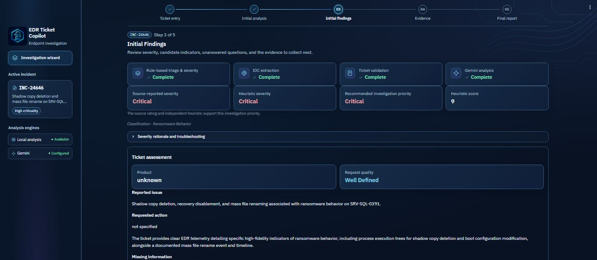
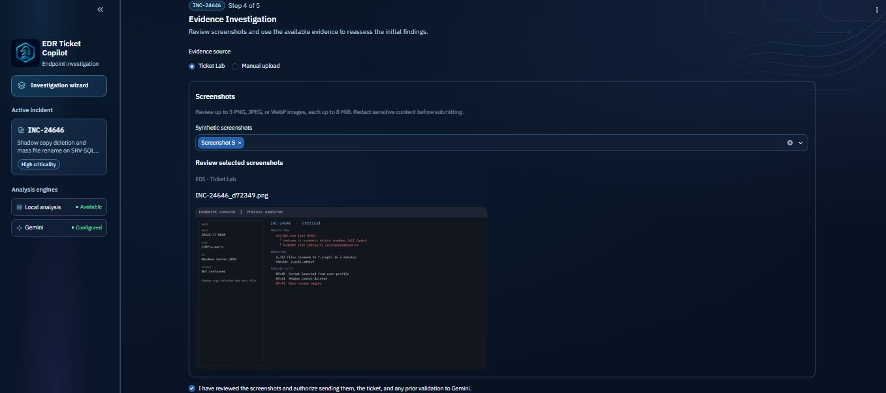
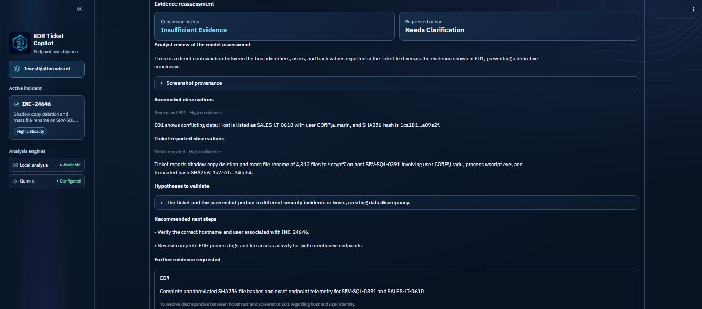

# EDR Ticket Copilot

**AI-Assisted Endpoint Security Investigation & Triage**

EDR Ticket Copilot is a Python-based investigation prototype designed to help endpoint security analysts triage incidents, interpret security alerts, assess supporting evidence, and generate structured investigation reports.

The project combines deterministic security rules with Google Gemini-assisted analysis through a guided five-step Streamlit workflow.

## Key Features

- **Guided investigation wizard:** Ticket Entry → Initial Analysis → Initial Findings → Evidence Investigation → Final Report.
- **Rule-based triage:** Local incident classification, heuristic severity scoring, and investigation priority recommendations.
- **IOC extraction:** Identification of candidate IPv4 addresses, domains, URLs, and cryptographic hashes, including partial-hash handling.
- **AI-assisted analysis:** Google Gemini integration for preliminary incident assessment, investigation recommendations, and evidence reassessment.
- **Screenshot evidence review:** Image validation, evidence identification, and comparison against ticket-reported information.
- **Evidence provenance:** Screenshot identifiers and SHA256 fingerprints to support traceability.
- **Structured reporting:** Exportable Markdown and JSON investigation outputs.
- **Synthetic incident testing:** Ticket Lab scenarios for investigating suspicious endpoint activity without requiring a production EDR environment.


## Application Screenshots

The following screenshots demonstrate the EDR Ticket Copilot
investigation workflow using synthetic incident data.

### 1. Investigation Wizard

Five-step guided workflow for endpoint security investigations.


### 2. Synthetic Ticket Lab

Generate, select, and load synthetic EDR incidents for testing.


### 3. Initial Findings

Rule-based severity assessment, IOC extraction, ticket
validation, and AI-assisted incident analysis.



### 4. Evidence Submission

Review and submit endpoint screenshots for evidence reassessment.



### 5. Evidence Reassessment

Detection of conflicting endpoint information across evidence
sources, with recommendations for further investigation.




## Technology Stack

- Python 3.11
- Streamlit
- Google Gemini API (`google-genai`)
- Pillow
- python-dotenv
- tldextract
- Python `unittest`

## Getting Started

### Prerequisites

- Python 3.11 or compatible version
- Git
- Optional: Google Gemini API key for AI-assisted features

### Installation

```bash
git clone https://github.com/prosteanvlad24-hub/edr-ticket-copilot.git
cd edr-ticket-copilot

python -m venv .venv
```

Activate the virtual environment on Windows:

```powershell
.\.venv\Scripts\Activate.ps1
```

Install dependencies:

```bash
pip install -r requirements.txt
```

### Gemini Configuration

Create a `.env` file in the project directory:

```env
GEMINI_API_KEY=your_api_key_here
```

Never commit API keys or credentials to version control.

### Run the Application

```bash
streamlit run dashboard_v1_2.py
```

Open the local address displayed by Streamlit, typically `http://localhost:8501`.

## Investigation Workflow

1. **Ticket Entry:** Enter incident details manually or select a synthetic Ticket Lab scenario.
2. **Initial Analysis:** Run local classification, severity assessment, IOC extraction, and optional AI analysis.
3. **Initial Findings:** Review preliminary results and investigation recommendations.
4. **Evidence Investigation:** Submit screenshots for reassessment and identify discrepancies between evidence sources.
5. **Final Report:** Review and export the investigation findings.

## Automated Testing

Run:

```bash
python -m unittest discover -v
```

The v0.4 development snapshot passed **11 automated tests**, covering incident regression scenarios, IOC handling, evidence processing, wizard integration, and report generation.

## Security and Limitations

This project is an investigation-support prototype, not a production EDR platform.

- Does not connect directly to live EDR consoles.
- Does not execute endpoint remediation or containment actions.
- Uses synthetic incident data for demonstrations.
- AI-generated findings require analyst verification.
- Screenshot content is treated as potentially untrusted evidence.
- API-based AI analysis requires appropriate data-handling authorization.
- Findings should not be interpreted as definitive malware attribution or root-cause confirmation.

## Project Status

**Version:** v0.4.0 — Initial public portfolio release

The project is under active development, with planned improvements to investigation workflows, evidence handling, and analyst usability.


## Author

**Vlad Proștean**

Cybersecurity Engineer | Endpoint Security | EDR/XDR | Python

GitHub: https://github.com/prosteanvlad24-hub
